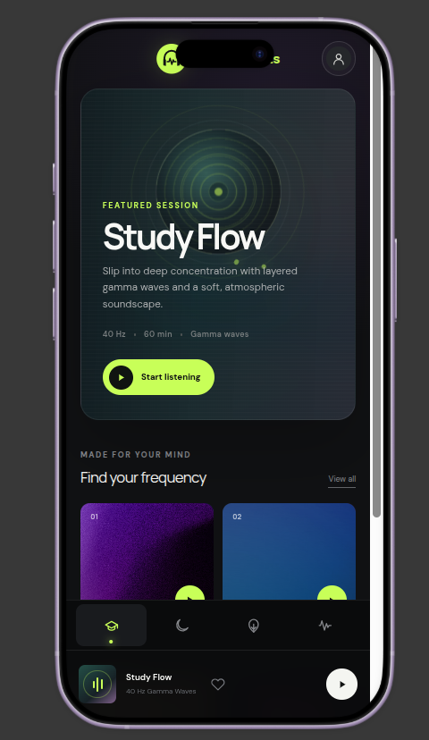
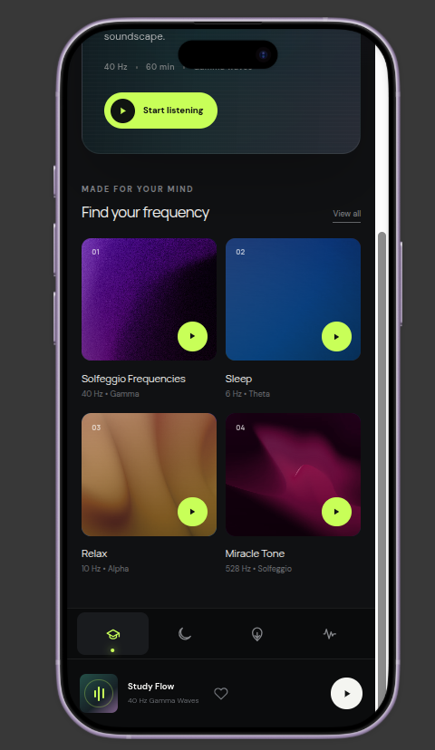
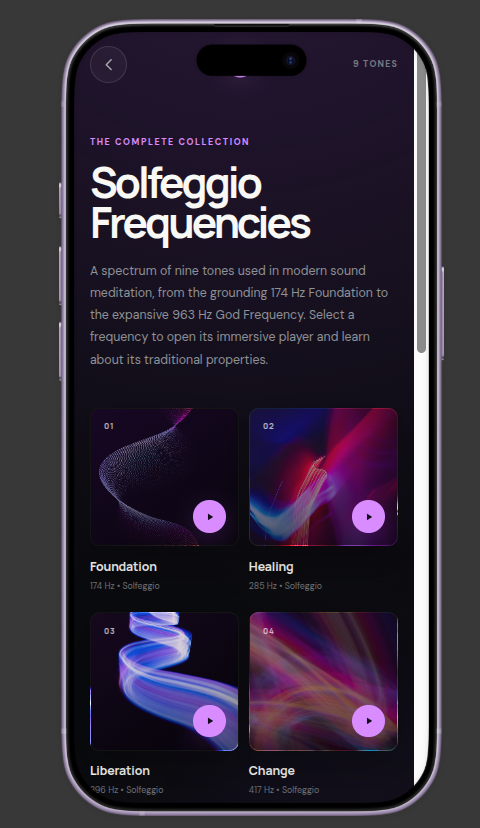
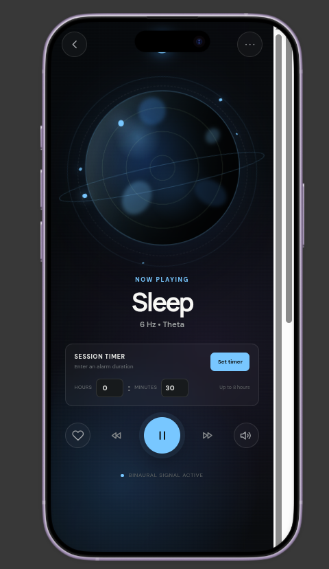
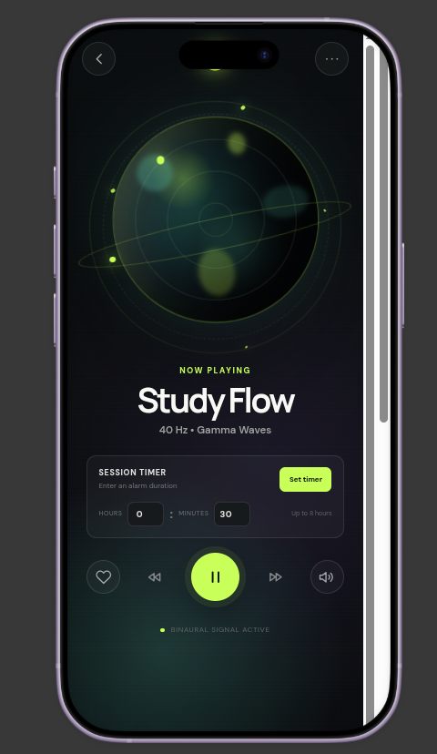
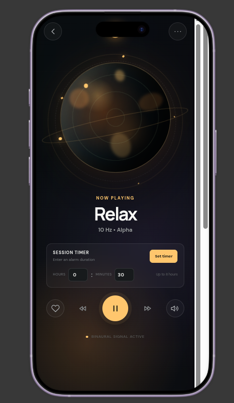
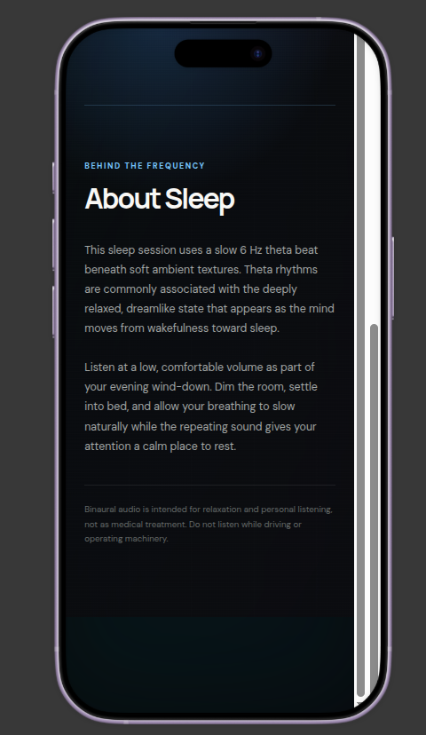

# Binaural Beats

An Android app for focus, relaxation and sleep. It generates binaural beats and pure Solfeggio tones in real time, layers them with soft ambient sound, and wraps everything in a dark, color-themed interface.

**[Download the APK (v1.0)](https://github.com/vishnurajvadakkenadayil-jpg/binaural-beats-app/releases/tag/v1.0)**

## Screenshots

  
  
  

  
  
  

  

## Features

- **Focus, relax and sleep sessions:** Study Flow (gamma), Relax (alpha) and Sleep (theta), each with its own color theme
- **Solfeggio frequencies:** a collection of nine pure tones, from 174 Hz to 963 Hz
- **Session timer:** set a duration of up to 8 hours
- **Favorites and mini player:** save sessions and control playback from any screen
- **About pages:** each session explains the idea behind its frequency, with a relaxation-only disclaimer
- **Google sign-in** with Firebase Authentication

## How it works

Audio is not played from prerecorded tone files. The app synthesizes the left and right channels in real time with Android's `AudioTrack`, using two slightly different sine frequencies so each ear hears a different tone. Pink or brown noise and an ambient soundscape can be mixed underneath.

## Tech stack

- Kotlin and Jetpack Compose (Material 3)
- Firebase Authentication and Google sign-in (Credential Manager)
- Coil for image loading
- `AudioTrack` for real-time audio synthesis

## Install

1. Download `BinauralBeats-v1.0.apk` from the [Releases page](https://github.com/vishnurajvadakkenadayil-jpg/binaural-beats-app/releases/tag/v1.0)
2. Open it on your Android phone
3. If asked, allow "Install unknown apps" for your browser or file manager
4. Use stereo headphones, since the binaural effect needs a different tone in each ear

Requires Android 7.0 (API 24) or higher. This is a debug build, so Android may show an "unknown app" warning.

## Build from source

1. Clone the repository
2. Create a Firebase project and add an Android app with package name `com.vishnuraj.binauralbeats`
3. Download `google-services.json` and place it in the `app/` folder (it is not included in this repo)
4. Build with `./gradlew assembleDebug`. The APK is created at `app/build/outputs/apk/debug/app-debug.apk`.

## Disclaimer

This app is intended for relaxation and personal listening, not as medical treatment. Do not listen while driving or operating machinery. Claims associated with Solfeggio frequencies come from modern wellness traditions and are not established by clinical research.

## Author

Vishnuraj V M, B.Tech CSE student at CUSAT Kochi.